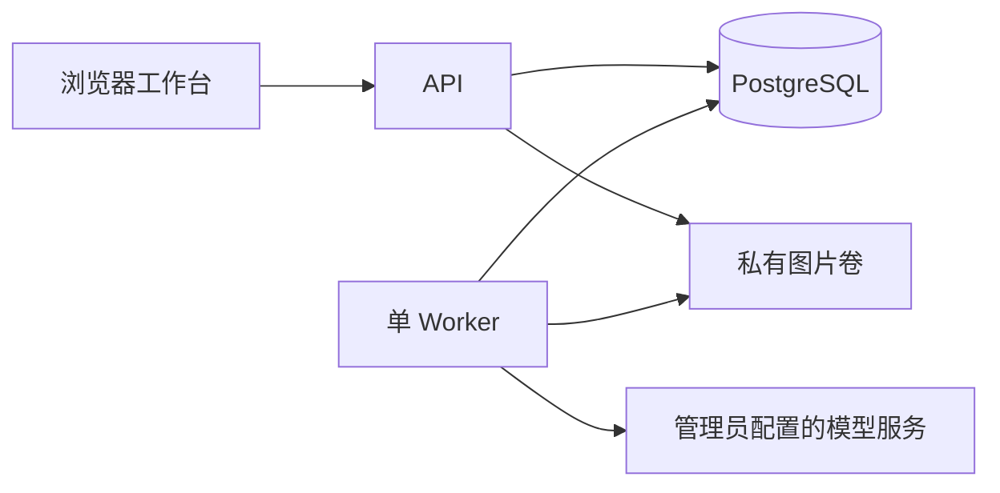

# 图一乐 · Tuyile

自托管的 AI 图片创作工作台：从提示词、参考图和 Agent 计划开始，在项目画布中组织结果、继续创作。

Tuyile 面向小规模、受控的多用户使用场景。管理员统一维护账号、模型服务和额度，每个用户拥有私有工作区。当前为早期版本，已完成本地功能与恢复验证，尚未提供托管服务或公开演示站。

## 能做什么

- **直接创作与参考编辑**：快捷示例、可编辑风格、模型/规格选择、画布图片引用，以及结果参数复用。
- **Agent 先规划后执行**：审阅或修改计划，确认后才预留图片额度并执行依赖步骤。
- **项目画布**：平移缩放、移动调整、分组对齐、撤销重做、来源关系和带版本的保存；冲突时保留本地内容。
- **个人素材库**：图库、提示池、私有收藏、跨项目复用、原图下载和有界 ZIP 导出。
- **后台任务**：关页、刷新和普通退出后继续执行，返回页面查看排队、生成及已保存结果。
- **管理与配额**：命名模型连接、对话/图像两个开放池、默认模型、个人策略、存储额度及结果待核验。

## 工作方式



前端使用 React、Ant Design 和 React Flow，API 使用 Hono，数据存储为 PostgreSQL，任务由一个独立 Node Worker 执行，状态通过 HTTP 轮询读取。业务与存储、文件、模型协议适配分开，技能和可信工具按版本注册。

Worker 中断后，运行中的任务允许失败或部分完成；未知调用不自动重发，不承诺重启续跑、多 Worker 接管或高可用。详见[产品边界](docs/product-baseline.md)和[架构设计](docs/architecture.md)。

## 本地启动

需要 Docker / Docker Compose，以及 [.node-version](.node-version) 指定的 Node。pnpm 版本由 package.json 固定，建议通过 Corepack 使用。

获取源码后，在仓库根目录执行：

```sh
corepack pnpm install --frozen-lockfile
corepack pnpm env:init
docker compose up -d --wait postgres
corepack pnpm db:migrate
```

首次使用按[账号初始化说明](docs/development.md#账号与密钥)安全注入 `ADMIN_USERNAME` 和 `ADMIN_PASSWORD`，然后运行：

```sh
corepack pnpm admin:init
corepack pnpm dev
```

浏览器访问 [http://127.0.0.1:5178](http://127.0.0.1:5178)。没有默认账号、默认密码或内置 API Key。管理员在“模型服务”配置自己的服务连接，发布模型和能力后，用户才能调用真实模型；调用费用由对应服务账号承担。

开发、自动测试与 Docker 验收使用独立数据库和图片目录。不要直接复制他人的 `.env` 或覆盖已有数据。完整命令见[本地开发](docs/development.md)；Docker 与 HTTPS 自托管见[运行手册](docs/operations.md)。

## 数据与安全

图片原件保存在私有文件卷，读取按工作区鉴权；管理员没有浏览其他用户作品的产品权限。服务 Key 加密保存在服务端，普通用户不接收 Key 或连接地址。

真实创作会把提示词和所选参考图发送给配置的模型服务，请使用可信服务并了解其数据政策。服务器维护者能够访问底层数据，本项目不提供端到端加密。日常额度控制也不等于模型服务账单金额上限。

公开部署前配置 HTTPS、精确 Origin、独立密钥和成套备份；不要把开发配置直接暴露到公网。报告漏洞和敏感信息请先阅读[安全政策](SECURITY.md)。

## 文档与贡献

- [文档索引](docs/README.md)：产品、架构、开发、运维与界面规范。
- [当前能力与后续方向](docs/delivery-roadmap.md)。
- [贡献指南](CONTRIBUTING.md)：开发环境、变更范围、验证和提交。
- [源码与镜像发布指南](docs/releasing.md)：许可、隐私、扫描与发布边界。
- [本轮开源准备检查](docs/open-source-readiness.md)：检查范围、结果和剩余注意事项。

欢迎可复现的问题报告与完整、聚焦的改进。请使用合成数据，提交前移除凭据、私人图片、绝对路径和未脱敏日志。

## 开源协议与来源

本项目原创贡献采用 [Apache License 2.0](LICENSE)。继承和依赖的第三方部分保留各自许可，不因本项目协议而重新许可。

界面 tokens、布局约定及部分创作辅助设计参考 [GPT Image Canvas](https://github.com/aruis/gpt-image-canvas)，其 MIT 许可保存在 [licenses/gpt-image-canvas-MIT.txt](licenses/gpt-image-canvas-MIT.txt)。完整来源及原生图片依赖条款见 [NOTICE](NOTICE) 和[第三方声明](THIRD_PARTY_NOTICES.md)。模型访问权、生成内容和上传素材的权利不由软件许可证授予。
