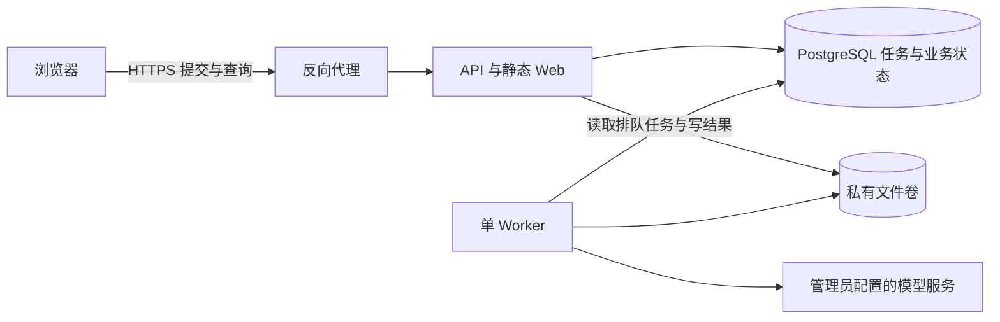

# Tuyile 架构设计

日期：2026-10-29。状态：轻量后台任务设计已确认；阶段 1—4 实现、自查与独立 review 已完成，后续效果图校准及最终页面验收继续推进。

本文以 [产品基线](product-baseline.md) 为业务来源。服务器多用户、PostgreSQL、独立 Worker、工程蓝和 A 布局继续保留。任务设计收敛为：**提交后后台排队，单 Worker 执行；Worker 正常运行时，关页、刷新、断网和普通注销均不影响任务。Worker 故障或重启允许任务失败，不承诺自动续跑。**

M2 后的结构审阅及已确认业务细化见 [架构专项治理](architecture-governance.md)。G1—G6 已随 M3 五步实现并通过自查、整体回归及独立 review；验收映射见 [M3工作台验收](acceptance/m3-workbench.md)。本地技术验收、效果图校准和最终页面验收继续按执行计划推进。

## 1. 目标与首版边界

1. 提交成功后，执行权从浏览器转交服务端。HTTP 请求结束、客户端断开或页面卸载都不是取消命令。
2. 任务、输入、状态、结果和额度保存在 PostgreSQL，原件保存在私有文件卷；持久化用于查询、归属和结算，不承诺进程中断后恢复执行。
3. 首版只运行一个 Worker 进程，可在用户/全局并发限制内同时执行少量任务；不是只能逐条串行，也不支持多个 Worker 副本。
4. API 独立重启而 Worker 与数据库正常时，后台任务可继续；整个后端、数据库或 Worker 故障超出正常运行保证，允许未完成任务失败。
5. 模块化单体、显式依赖与事务、选择性复用已有能力；新模块/表按完整业务链需要增加，不提前建设通用任务平台。
6. 不纳入多 Worker 接管、任务租约/心跳/fencing、自动恢复执行、持久化进度事件流、SSE 可靠重放和端到端 exactly-once 承诺。后续确有需求再单独设计。

允许极端情况下失败，不意味着正常提交可以只写浏览器内存，或先返回成功再入队。首版保留少量必要的任务、调用与额度记录，避免重复生成、无归属任务和重复扣额。

## 2. 技术与部署基线

| 层 | 建议 | 边界 |
| --- | --- | --- |
| 工程 | TypeScript 单仓库、pnpm workspace | 工程起步固定稳定的 Node LTS、包管理器和依赖版本 |
| Web | React、Vite、React Flow、显式路由 | 服务端状态、项目文档和本地编辑状态分开 |
| UI | Ant Design 6.6.8、工程蓝 tokens、共享薄封装 | A 布局和可折叠侧栏；不整套复制参考项目组件库 |
| API | Node.js、Hono、独立组合入口 | HTTP 校验/鉴权/准入/查询，不执行或拥有长任务 |
| 数据 | PostgreSQL；Drizzle + node-postgres | 连接池、短事务、版本化 SQL；不同时维护 SQLite 可写后端 |
| 执行 | 一个独立 Node Worker，轮询数据库待处理任务 | 进程内管理正在执行的工作与并发；无独立消息中间件 |
| 进度 | 前端 HTTP 轮询任务列表/详情 | 只读取状态快照，不依赖连续连接或事件重放 |
| 原件 | 私有本地文件卷、存储端口接口 | API/Worker 共享卷；数据库存元数据和关系，不存大图片字节 |
| 验证 | 建议 Vitest、Playwright、真实 PostgreSQL 集成测试 | 单实例队列、权限/额度事务、浏览器和中断失败行为是验收重点 |



API 和 Worker 可使用同一个镜像、不同入口，进程生命周期分开。首版单主机 Compose 提供 API、一个 Worker、PostgreSQL 和私有卷；数据库不暴露公网。API 不通过 HTTP 请求的 AbortSignal 控制已准入任务，Worker 不持有浏览器 Cookie。

## 3. 分层、模块与工程组织

### 3.1 依赖边界

```text
HTTP / Worker / CLI 入口
          ↓
应用用例：授权、事务与业务动作编排
          ↓
领域规则：额度、任务状态、计划、画布与引用约束
          ↑
基础设施适配器：PostgreSQL、文件存储、Provider、时钟
```

- 组合入口显式创建依赖；禁止导入模块即连接/迁移数据库、扫描任务或读取全局运行配置。
- 用例内仓储共享同一事务连接；领域不依赖 Hono Context 或具体数据库驱动。
- 查询 DTO 可以用专用参数化 SQL，但始终带服务端授权上下文，只选择允许公开的字段。
- 不改写 `window.fetch`，不依赖全局当前项目/模型；不建设全能 Repository、双数据库抽象或通用工作流引擎。

### 3.2 模块职责

| 模块 | 职责 |
| --- | --- |
| identity / workspace | 账号、会话、个人工作区、授权与执行撤销版本 |
| projects | 项目、画布文档、revision、冲突与项目删除 |
| assets | 原图/预览、上传校验、引用、容量、删除与清理 |
| creation / tasks | 创作输入、Agent 计划、队列、执行状态、取消、结果与中断失败 |
| quota | 整单预留、计次、释放、尝试/频率/存储上限和幂等结算 |
| providers | 允许模型、配置版本、密钥引用、调用适配和安全错误分类 |
| skills / tools | 声明式创作技能、可信工具注册、版本/依赖校验；执行仍经过统一授权、确认与结算 |
| library / administration | 私有图库/收藏、公共提示池、账号/策略、脱敏统计和待核验处置 |

任务执行和额度结算在用例的同一事务内协调；画布编辑不触发 Provider。首版 Agent 作业按计划依赖顺序执行，先做好确认、输出和失败反馈，不为作业内并行额外建设调度平台。

### 3.3 建议目录

```text
apps/
  web/                 # 路由、功能页、画布与 API 客户端
  api/                 # HTTP 适配和 API 组合入口
  worker/              # 单实例启动、轮询/执行和退出
packages/
  contracts/           # 输入/输出 schema，无服务端密钥类型
  core/                # 按业务组织领域规则、用例和必要边界接口
  infrastructure/      # PostgreSQL、文件和 Provider 适配器
  ui/                  # 实际复用的组件与 tokens
migrations/            # 审阅过的版本化 SQL
scripts/               # 受控运维与本地验收
```

目录随实际需求建立，不预建空包或未来表。测试辅助代码在确有复用时抽取；core 按模块划分，不为每个实体再建独立 package。

## 4. 必要数据与事务

### 4.1 数据职责

| 数据 | 用途 |
| --- | --- |
| users / sessions / password_tokens / workspaces / workspace_members | 身份、会话、一次性令牌、个人工作区与执行授权 |
| projects / project_documents | 项目、画布 JSONB、revision |
| tasks | 输入、归属、状态、幂等键/摘要、配置版本、取消标志、错误码、结算状态和时间 |
| provider_attempts / task_outputs | 已开始的上游调用及预期/已完成输出；防止重复调用或扣额 |
| quota_accounts / quota_reservations / quota_entries | 按用户/统计日/类型预留、消费、释放与唯一结算来源 |
| assets / asset_variants / asset_references | 文件元数据/校验、预览、授权引用和删除保护 |
| conversations / messages / plans / task_steps | 在 Agent 交付时增加，仅表达实际对话、确认版本和计划作业进度 |
| provider/config/secret versions、favorites、audit | 分别支撑服务配置、个人收藏与审计；按对应业务交付建立 |

不建立 task_events、task_event_streams、租约、admission_slots 或 execution_slots 表。队列占用从任务状态查询，执行并发由唯一 Worker 的进程内集合控制；数据库任务状态和额度账仍是查询/结算权威。

### 4.2 隔离与原子性

- 内容表的 workspace 非空，父子关系使用 workspace 复合外键；API 和 Worker 都从已验证主体/任务得出访问上下文，不信任客户端 owner。
- 任务准入在同一事务检查账号、项目、幂等键、模型/规格、队列容量和额度，保存输入/引用并预留整单后才返回 202 与任务 ID。输入和资产 pin 不随页面、会话或注销清理消失。
- Queue 容量独立于执行并发：执行槽满但队列尚有容量时允许排队；队列满才返回 429。用户/全局队列上限必须有限并参数化，默认值在实现时随用量和等待体验验证；不复用“并发满即拒绝”作为排队策略。
- API 可并发提交，容量检查与插入必须使用共同的短事务互斥规则，不能无锁先 count 再 insert。额度不足仍整单拒绝，不自动拆分/降质。
- 任务领取使用 `queued → running` 条件更新；成功输出、额度和任务状态同事务结算，唯一输出/结算来源阻止重复写入。
- 画布保存比较 revision，并同事务同步引用。增加引用/任务 pin 和资产删除用相同资产锁；项目删除与任务准入用相同项目锁。
- 锁顺序固定，例如账号/工作区 → 项目 → 额度/队列控制 → 资产（按 ID 排序）→ 任务。事务内不做网络、长解码或大文件操作。
- 运行数据库身份不能改 schema；迁移独立执行。RLS 不是首版前提，也不把 PostgreSQL 当成自动授权保证。
- 普通授权查询不获取创作全局写锁、不锁用户行或初始化额度；列表批量读取输出。写操作按实际竞争对象互斥，全局容量仅保留短准入锁。移除现有全局锁前统一各写路径的锁顺序，并验证撤销/dispatch、引用/删除及结算竞争；详见专项 G3。

## 5. 轻量任务队列与执行

### 5.1 正常流程

1. 用户提交直接生图、参考图请求或确认 Agent 计划，服务端事务准入并返回任务 ID；规划任务只产出草案，未确认的图片计划不会执行。
2. Worker 定期读取已提交的 queued 任务，在用户/全局并发允许时条件更新为 running。轮询循环不能重叠启动同一任务；进程内保存正在执行的 Promise、AbortController 和并发计数即可。
3. 每次实际调用前重新检查取消/账号授权、模型/配置、attempt 预算和 deadline，写入必要调用记录，再在事务外调用 Provider。
4. 原图验证并保存后，事务提交资产/输出、进度和额度结算。前端随后轮询即可看到结果。
5. 用户关页、刷新、断网或普通退出登录不会结束这个 Promise、删除任务或释放额度；重新登录后可查询自己的任务及已落盘结果。

首版状态保持业务可读：`queued / running / succeeded / partial / failed / cancelled`。取消是标志/操作，确认停止前不能伪装成已取消。未知上游结果使用失败原因及独立的 `pending_review` 结算标记呈现，不另造一套可接管执行的状态机。

### 5.2 单实例保护与故障边界

- Compose 仅配置一个 Worker。启动使用一个 PostgreSQL session 级 advisory lock 防止误开第二实例，锁绑定独立固定连接，不放回连接池；未取得锁立即退出。这不是逐任务租约或多实例接管。
- 固定连接断开或锁状态无法确认时，Worker 停止领取/发新调用并退出，尽力取消在途工作；不能自动重连后继续旧执行。新进程取得单实例锁前不得分类旧任务或启动工作。
- 启动时，原 running 任务标记为执行中断：保留已经 ready 的输出，其他步骤不自动接着运行。没有成功输出则 failed，有成功输出则 partial，并显示中断原因。
- 原 queued 任务从未领取过且必要数据完整时，可以经正常授权、预算和过期检查后按队列流程执行；不承诺任何故障下队列必不丢失。数据库/输入损坏导致不能执行时明确失败，不伪造成功。
- 已记 dispatched 但结果不明的调用标 unknown；对应图片预留和必要引用保持待核验，不能因任务显示 failed/partial 就一律释放。规划已计用及上游尝试次数也不重置。
- API 单独重启不扫描/失败化 running 任务；这些由唯一 Worker 正常执行。只有 Worker 启动取得独占后才分类前次中断，避免 API 重启误伤正常任务。
- 正常关闭 Worker 先停止领取，并等待活动任务至有限关闭期限；超期或强制退出允许中断失败。数据库/文件卷灾难恢复和真实数据迁移另按运维流程处理。

首版不做执行自动接管、跨 Worker 租约/心跳/fencing、自动恢复 Agent 图或可靠进度事件流。进程中断后的“标失败、保留结果和结算证据”是清理与可解释性，不是恢复执行承诺。数据库连接故障下已发出的上游请求可能继续运行，取消始终是最佳努力。

### 5.3 保留的费用与重复保护

- 幂等键绑定 user/workspace/project 和操作类型，同时保存输入摘要：同键同输入返回原任务，同键异输入冲突。确认响应丢失或刷新后先查任务，不自动换新键重提。
- Provider 明确拒绝、能力适配确认安全可重试时，运行中的任务最多一次自动重试；网络超时/连接中断的未知结果不重发。用户显式新重试重新鉴权和预留。
- 整份 Agent 计划原子预留图片，规划只在首次调用开始计一次；格式修复最多一轮，与原调用共用 token/步骤/超时预算。
- 图片/规划预留按创建统计日结算，上游尝试按实际 dispatched 统计日限制；排队跨日不能绕过当日尝试上限。deadline 不因刷新/重启延长。
- 调用前持久化 dispatched 是在途分界；此后取消/停用/重置可能仍产生费用。崩溃后不能证明是否发送时保守记 unknown，而非猜测未发生。
- pending_review 不占正在执行并发，但保留相关额度/输入 pin；管理员基于证据幂等处置。已持久化成功输出可查，明确未启动的部分释放。晚到结果不能覆盖已完成的人工处置或再次计次。
- 接收时固定配置/模型/密钥版本引用，新任务使用新配置；密钥不复制进任务明文输入、查询 DTO 或日志。紧急停用版本阻止后续调用，不静默换 Provider 重发。
- 图片消费必须关联本地成功持久化输出，上游成本和尝试独立记录；确认无法取得图片时释放未知预留，不能通过人工确认收费增加图片消费。预留/流水与汇总同事务维护，按唯一业务来源防重复；专项 G2 修正 M2 核验路径的口径差异。

### 5.4 服务能力、技能与工具

规划和图片各一个当前有效服务配置，允许不同服务商；管理表单输入、服务端执行配置和用户可见模型能力分开。请求准入遵循产品支持、模型能力和用户策略的交集。规划与图片适配接口独立，平台统一控制重试、预算和取消。

技能注册不可变创作指导版本及工具依赖，可信工具注册类型化输入/输出、权限及副作用声明。计划确认绑定实际版本；普通停用阻止新规划/确认，紧急撤销阻止后续 dispatch。版本缺失/不兼容明确拒绝，不自动替换为最新实现。首版无任意第三方代码加载，执行工具不能绕过业务用例。最低契约及验证见专项 G5—G6。

## 6. 会话与前端状态查询

### 6.1 会话不持有任务

任务记录账号/工作区/项目、必要输入和接受时的执行授权版本，不依赖活跃 Cookie 或连接。

- 普通注销只结束当前设备会话；清理 session 不能级联删除任务、输入、引用或额度。
- 密码重置/修改、停用撤销全部会话并更新执行授权版本；未开始任务取消，在途尽力取消。重新启用不复活旧任务。
- Worker 每次发出调用前检查当前 enabled、workspace 关系、授权版本与 cancel flag。校验和 dispatch 记录与撤销动作共享账号锁，记录提交后视为在途。
- 用户显式取消是单独命令；轮询失败或页面不可见不是取消命令。

### 6.2 轮询快照即可

- HTTP 提供任务提交、列表、详情、取消和授权结果访问。前端对当前项目的活动任务、近期任务或已知任务 ID 轮询完整状态；查询有分页和数量上限。
- 轮询只读，不创建任务、不推进 Agent 图、不计模型调用。离开页面可以停止轮询，但后台执行不受影响。
- 状态/输出事务提交后即可被下次查询读取；没有持续连接需要保持，也没有必须按顺序收到的进度事件。
- 普通历史列表分页只用于浏览，不拿时间戳/sequence 当可靠通知游标。暂不建立 task_events、提交顺序计数行、SSE 重放、Last-Event-ID 或数据库通知机制。
- 重新打开页面读取当前项目任务快照和已保存结果。前端按 task/output ID 更新缓存与画布落图记录，重复查询不重复落图；被用户移除的节点不自动复活。
- 每个查询都鉴权/校验归属；退出后查询返回 401，重新登录才可查看。管理员不能通过任务查询获得他人正文、原图或结果。

## 7. 资产、引用与文件一致性

首版继续保留上传格式/字节/像素限制、受限解码、私有授权读取和存储额度。这些保护与多 Worker 或重启续跑无关。

- 原件使用 staging → ready → deleting → deleted 的生命周期；逻辑 asset ID 与随机文件 key 分离。
- 先预留空间并记录资产写入意图，再流式接收/解码/校验/hash；同卷安全发布文件，确认 ready 后提交输出及额度。同步必要文件/目录元数据，不能用 rename 可见性假装断电持久性。
- 数据库和文件没有共同事务。中断允许任务失败；检查实际 ready 文件、清理 staging/孤立文件和核对存储计量即可，不为凑完整结果重发模型调用。不能把未验证文件算作成功，也不能删除已经向用户呈现的 ready 原图。
- 明确的资产写入记录、哈希与输出关联用于核对文件归属；无法证明是本次已完成输出的孤立文件留待清理/核验，不自动挂到任务并恢复执行。
- 引用关系随画布、消息、确认计划、任务 pin 和收藏保存事务更新。首版可采用有限引用源列、CHECK 恰有一个源、workspace 复合外键，不做通用引用插件。
- 新引用/任务 pin 与删除共用资产锁；引用源和 asset 必须同 workspace 且可用。当前文档更新替换引用集，历史归档不自动形成永久活动 pin。
- 删除先标 deleting，拒绝新增引用，物理回收成功后再释放存储；失败清理可幂等重试，不虚报已释放容量。
- 活动或待核验任务继续保护项目与参考图。删除项目清除内容引用，保留 Gallery 原件；已完成输出关联用于追溯，不永久阻止删除，原图删除后查询显示已删除。
- 原图、预览、下载、导出统一授权；图片目录不作为公共静态资源。首版不启用云回退或公开对象链接。

## 8. 前端与安全边界

- 显式项目路由和 API 客户端；查询状态与画布 editor store 分开，不把项目/模型塞进全局 fetch 拦截器。
- 保存带 revision、串行队列和冲突保留。切页/项目/注销前保存草稿，失败留在原上下文并提供明确恢复或放弃选择；异步响应绑定 workspace/project/epoch。
- Agent 先生成草案，确认后排队；画布几何操作、撤销、轮询和重复读取都不产生模型调用。
- 界面显示排队/执行/完成/失败、已保存的部分结果、消耗和预留。中断时说明需要用户显式重试；pending_review 解释为结果待核实，不能提供盲目重试。
- 工程蓝/A 布局与 B 折叠窄轨保留，以已认可效果图为视觉依据。优先中大型桌面，不再建设手机专用交互；键盘操作、焦点和可读性保留。视觉约束见 [UI 方向](ui-direction.md)。
- Cookie 采用 HttpOnly/Secure/SameSite，精确 Origin/CSRF 校验；内容查询、原图和下载都按 workspace 授权。
- 配置显式加载，开发/测试/生产数据隔离；密钥留在服务端，建议加密保存版本，主密钥由独立部署环境保管。备份与主密钥恢复成套说明。
- 安全日志记录 request/task/attempt ID、错误码和耗时，不打印 Key、令牌、完整正文或原始 Provider 错误；管理员只看脱敏运行信息。
- 初期观测队列长度/等待、正在执行数、任务成功/失败/中断、待核验数量、拒绝率及磁盘低水位；不为未采用的租约/事件系统建设监控。

## 9. 迁移、验证与推进

### 9.1 选择性复用与旧数据

保留产品规则、画布格式/几何操作、Provider 适配、计划约束、配额语义及验收场景。重新组织全局数据库、会话调度、前端隐式状态和历史迁移；不把旧断线取消逻辑带进新后台执行。

- 2026-10-30 用户明确无旧业务数据迁移需求：不建设 SQLite 导入、ID/归属映射、检查点与旧内容转换，不访问旧项目私有数据。
- 本地合成环境验证独立运行、数据库与私有文件卷成套备份恢复、哈希/关系/额度完整性；恢复不承诺续跑任务。
- 保留旧工程作为行为参考，公开部署不在当前执行范围。

### 9.2 首版验收重点

1. 双账号正反向权限矩阵，覆盖提交、查询、取消、原图/预览/下载/导出/引用和管理员无内容特权。
2. PostgreSQL 真实事务下的并发准入、队列满/执行满、幂等重放/冲突、整计划预留、跨日/降额、删除与引用/准入竞争。
3. **Worker 保持正常运行时**，提交后关闭/刷新浏览器、断网、普通注销不影响执行；重新登录可轮询结果和额度。API 单独重启不取消 Worker 中任务。
4. 第二 Worker 不能启动；单 Worker 循环不重复领取。Worker 退出/中断后原 running 明确失败或部分完成，queued 只经正常检查启动，绝不自动续跑旧运行步骤或重发未知调用。
5. 取消/停用/重置与 dispatch 分界；已计次数不因中断消失，unknown 图片预留不会全部释放，已 ready 输出保留。
6. 正常 Provider 错误、安全重试和一次规划修复共享预算；任务超时有界，用户显式重试重新准入。
7. 文件/DB 提交间故障可标任务失败，但已确认成功的原图不丢、孤立文件/预留不会被伪造为成功或永久漏计。
8. 画布保存/刷新/冲突、重复轮询不重复落图、被移除节点不复活；Gallery 复用和删除保护、中大型桌面操作正常。
9. HTTPS/轮询及独立数据库/文件卷备份恢复；已有持久化结果可查，不把备份恢复当执行续跑验收。
10. 所有自动测试是假账号/Provider；真实模型烟测的模型、次数和费用另行批准。

### 9.3 推进与未来能力

完整交付仍为：工程/账号基础 → 单 Worker 后台创作及额度 → 完整创作工作台 → 本地运行与发布技术就绪。详细范围见 [执行计划](exec-plans/active/tuyile-foundation.md)。每阶段完整完成后统一提交、自查和一次独立 review；文档修订只做文档检查，尚不存在的应用脚本不声称通过。

多 Worker、执行接管、SSE/推送进度、持久化事件重放、队列服务及高可用都不是首版预留代码。保持业务状态、用例和适配边界清晰即可；以后需要时新增设计和迁移，不以长期扩展为由现在实现。

部署前再确认主机、域名/HTTPS、数据/备份/主密钥位置、维护窗口和恢复目标。技术机制参考 [PostgreSQL advisory locks](https://www.postgresql.org/docs/current/explicit-locking.html#ADVISORY-LOCKS)、[Drizzle PostgreSQL](https://orm.drizzle.team/docs/get-started-postgresql) 与 [显式迁移](https://orm.drizzle.team/docs/migrations)；具体稳定版本在工程起步时固定。
