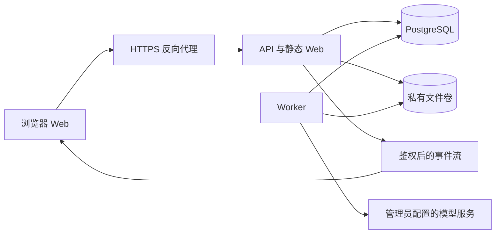

# Tuyile 架构设计

日期：2026-10-29。状态：架构复核、自查和一次独立 review 已完成，作为后续工程实现基线；应用代码尚未开始。

本文以 [产品基线](product-baseline.md) 为业务来源。用户已确认服务器多用户、PostgreSQL、独立 Worker、关页和普通注销后任务继续执行，以及“先搭中期基础、分层切割、不堵长期道路，再尽快上线”。具体技术选型、模块与表设计是本文的工程建议，尚未安装依赖或启动实现。

## 1. 设计目标与约束

1. 已确认的工作由服务端持有，浏览器、API 与 Worker 各自可重启；已落盘结果可恢复，未知上游结果不盲目重发。
2. 工作区隔离、额度、任务准入、文件引用和取消规则有统一权威来源，不依赖客户端自报 owner 或进程内 Map。
3. 业务逻辑能够在 HTTP、Worker 和受控迁移命令中复用；边界显式，避免全局可变数据库/项目/模型状态。
4. 以一个仓库、模块化单体和少量进程满足中期需求，保留多 Worker、私有对象存储与团队成员关系的演进位置。
5. 已验证代码和验收场景选择性迁移；历史兼容集中在离线导入工具，不污染新运行时。
6. 首版可运行于同一台服务器的 Web/API、Worker、PostgreSQL 与私有文件卷。Docker Compose 是首选交付方式；不承诺首版多机高可用。

## 2. 推荐技术基线

| 层 | 建议 | 理由与边界 |
| --- | --- | --- |
| 工程 | TypeScript 单仓库、pnpm workspace | 继承已有类型与团队经验；包管理器、Node LTS 与依赖在工程起步时固定版本 |
| Web | React、Vite、React Flow、显式路由 | 延续画布/业务积累；路由、服务端状态和画布本地编辑状态分开管理 |
| UI | 语义设计 tokens、共享基础组件、lucide 图标 | 工程蓝与 A 布局为已确认方向；不整套复制参考项目组件库 |
| API | Node.js、Hono，独立组合入口 | 保持传输层轻量，领域不依赖 Hono Context |
| 数据 | PostgreSQL；Drizzle + node-postgres | 显式连接池/事务、类型化 schema 与版本化 SQL；关键锁/队列语句可用审阅过的参数化 SQL |
| 执行 | 独立 Node Worker、数据库任务领取/租约/事件 | 执行生命周期脱离浏览器和 API 连接；首版不增加独立消息中间件 |
| 原件 | 私有本地文件卷、存储端口接口 | 数据库保存元数据/关系，图片字节不存主业务表；API 与 Worker 共享私有卷 |
| 验证 | Vitest 为建议统一运行器，Playwright 浏览器测试，真实 PostgreSQL 集成测试 | 继承验收场景，不用 SQLite 替代 PostgreSQL 锁/隔离测试 |

这些是工程建议，不是必须全部重写的理由。实现选定稳定版本，不因官方示例使用 RC 就引入预发布依赖。首版只维护 PostgreSQL 运行后端，不同时维护 SQLite/PG 两套可写实现。SQLite 仅作为旧数据导入来源。

## 3. 部署结构与执行方向



- 浏览器通过 API 提交命令、读取状态、上传/下载授权资产并订阅事件；不直接访问数据库、文件目录或上游 Key。
- API 完成鉴权、校验、准入事务并返回稳定任务 ID。用户可关闭页面，无需保持 WebSocket。
- Worker 读取已提交任务，重建最小执行上下文，领取可运行步骤，调用 Provider 并持久化输出/结算。
- API 和 Worker 可从同一镜像以不同入口启动；代码共享不代表状态共享。任一进程内缓存都不是任务、权限或额度的权威。
- Web 静态文件可由 API 或代理提供，API 与浏览器保持同源；数据库仅在内部网络开放，应用只向反向代理提供服务。

## 4. 分层、模块与目录

### 4.1 依赖约束

```text
HTTP / Worker / CLI 入口
          ↓
应用用例：鉴权上下文、事务编排、业务动作
          ↓
领域规则：任务状态机、额度、计划、画布及引用约束
          ↑
基础设施适配器：PostgreSQL、私有存储、Provider、时钟、事件读取
```

领域规则定义所需的小接口；基础设施实现它们。组合入口创建连接池、配置和具体适配器并注入应用用例。API、Worker 不越过应用用例直接拼业务 SQL。

- 禁止导入模块即连接数据库、改 schema、恢复任务或读取全局配置。
- 一个用例中的仓储必须使用同一个事务连接；不能每个仓储各开事务。
- 读模型可用专用 SQL 直接形成 DTO，但必须使用统一授权上下文和安全字段选择。
- 只抽象实际边界，不设计全能 Repository、跨数据库通用查询语言或完整插件框架。

### 4.2 业务模块

| 模块 | 拥有的职责 |
| --- | --- |
| identity | 账号、会话、激活、密码、角色、执行授权撤销版本 |
| workspace | 个人工作区、成员关系及访问上下文 |
| projects | 项目、版本化画布、revision、保存冲突与项目删除 |
| assets | 原件/预览、归属、校验、引用关系、存储预留、删除与回收 |
| creation | 创作输入、已确认计划版本、直接生成与参考图任务定义 |
| tasks | 生命周期、步骤、attempt、租约、取消、事件、恢复与对账 |
| quota | 按归属日预留/消费/释放、尝试/频率/存储上限与幂等结算 |
| providers | Provider 能力、适配、配置版本、模型策略与密钥引用 |
| library | Gallery 查询、公共提示池、个人收藏与分组 |
| administration | 账号/策略维护、脱敏统计与错误查询、审计和未知结果处置 |

任务模块负责执行状态，quota 模块负责额度账；二者在应用用例的共同事务内协调。画布保存不调用 Provider。管理查询不复用内容详情查询绕过 workspace。

### 4.3 建议目录

```text
apps/
  web/                       # 路由、功能页、画布、API 客户端
  api/                       # HTTP/SSE 适配与 API 组合入口
  worker/                    # Worker 启动、领取循环、关闭处理
packages/
  contracts/                 # API 输入/输出 schema、事件协议；无服务端密钥类型
  core/                      # 按业务模块组织领域规则、应用用例与边界接口
  infrastructure/            # PostgreSQL、存储、Provider 等适配器
  ui/                        # 已实际复用的基础组件、tokens；不提前造完整设计系统
  test-support/              # 隔离测试 fixture、假 Provider、数据库测试工具
migrations/                  # 审阅过的版本化 SQL
scripts/                     # 受控运维与离线导入命令
```

`core` 内按业务模块分包/目录，应用层和领域层明确区分；首版不为每张表建立独立 package。具体目录可在实现时小幅调整，但依赖方向和数据所有权保持不变。

## 5. 数据模型与事务边界

### 5.1 核心实体

| 实体组 | 作用与关键约束 |
| --- | --- |
| users / sessions / password_tokens | 密码哈希、凭据版本、执行撤销版本；会话/令牌仅存摘要 |
| workspaces / workspace_members | 首版 personal；每用户一个个人 workspace，成员关系为未来扩展保留 |
| projects / project_documents | 项目归属、画布 JSONB 与 revision；旧版文档升级采用显式版本转换 |
| conversations / messages / plans | 对话与消息稳定 ID；草案和确认版本分离，确认后计划内容不可变 |
| assets / asset_variants / asset_references | 原件、预览及哈希；工作区级逻辑 ID；结构化引用与生命周期状态 |
| tasks / task_steps / task_outputs | 一个用户操作、可执行步骤、输出槽位；保存归属、准入配置版本及幂等身份 |
| provider_attempts | 每次可能发生费用的上游调用；请求/响应模型、请求 ID、预算、状态、恢复证据 |
| task_event_streams / task_events | 工作区事件流游标及安全事件；与状态改变同事务提交，游标按可见提交顺序推进 |
| quota_accounts / quota_reservations / quota_entries | 按用户/归属日/类型记录额度，来源唯一，消费/释放不重复 |
| admission_slots / execution_slots | 有界准入及本地可观测执行并发；按用户/全局、图片/规划分别约束 |
| provider_configs / config_versions / secret_versions | 不可变非敏感配置与受控密钥版本引用，运行状态独立于密钥字节 |
| favorites / favorite_groups | 工作区私有收藏，来源链接与内部资产引用分开处理 |
| audit_events / import_runs / import_mappings | 安全操作元信息、导入检查点/来源 ID 映射，不保存敏感请求正文 |

### 5.2 工作区隔离

- 每张内容表有非空 `workspace_id`；子实体通过 `(workspace_id, parent_id)` 复合外键与父实体关联，拒绝跨 workspace 关系。
- 服务端从 session 得出 Principal，再构造显式 WorkspaceAccess；仓储读写必须带它，忽略客户端提交的 owner/workspace 权威声明。
- Worker 使用任务中已验证的归属加服务端实时执行授权检查，不伪造浏览器会话。
- 数据库迁移角色与运行角色分离，运行角色不能改 schema。首版以应用授权、关系约束和完整权限矩阵建立隔离；RLS 可作后续额外防线，不将“已用 PostgreSQL”当作自动隔离保证。
- JSONB 适合画布/计划结构，但其中的 asset ID 必须经应用验证并同步引用关系，不能把 JSON 隐藏字段当作权限边界。

### 5.3 原子用例

- 提交任务：校验项目/账号/模型/规格；锁定同一组账号/限额与准入记录；确认幂等；预留整单额度和所需引用；建立任务/步骤/事件；共同提交。
- 成功输出：原件已验证并安全发布后，建立 asset/output/reference，完成对应额度结算和安全事件；共同提交。
- 取消/撤销：持久化取消标志、阻止后续步骤、释放能确认未启动的预留并记录事件；在途通过 Worker 最佳努力取消。
- 保存画布：校验文档及归属，比较 revision，同步项目文档与资产引用，递增 revision；共同提交。
- 删除资产：与增加引用使用相同的资产锁协议；检查引用/任务 pin，标记 deleting 并创建回收意图；事务提交后再删除物理文件。
- 删除项目：与准入使用相同的项目锁协议；确认无活动/待核验任务，清除内容和对应引用，保留必要的审计/用量关联及 Gallery 原图。

所有用例采用一致锁顺序，推荐账号/工作区 → 项目 → 额度/准入记录 → 资产（按 ID 排序）→ 任务/步骤，并在具体实现中为新增引用/取消等定义兼容顺序。事件流计数行最后加锁，之后不再取得新的业务锁。短事务内不做 HTTP、图片解码或长文件操作。死锁/序列化失败仅重试可证明无外部副作用的数据库事务，不重试整个 Provider 用例。

## 6. 任务执行、恢复与费用安全

### 6.1 对象职责

- Task：一次用户操作，是幂等、归属、取消及额度预留的根；确认的计划作为其不可变输入。
- Step：一次规划步骤或图片作业，依赖关系来自已验证计划；任务内部可按能力分配多个输出槽位。
- Attempt：一次实际准备发往上游的 HTTP 调用。安全重试建立新的 attempt，不覆盖原证据；同一步骤可能有多次 attempt，但预算共享。
- Output：预期输出槽位和最终持久化资产。以唯一键防止重复落图/结算；浏览器节点只引用它，不拥有执行状态。

直接图片任务无需 Agent 规划；规划任务产生草案，只有用户确认计划后才建立图片执行任务并预留图片。

### 6.2 生命周期

任务的业务状态与 Worker 调度状态分离：

```text
accepted → running → succeeded / partial / failed
    │          │
    └── cancel_requested → cancelled / partial / needs_review
               │
               └── needs_review → 管理员基于证据幂等结算为终态
```

`needs_review` 表示至少一个调用结果无法确认，不自动进入普通重试队列。已成功输出始终可查；任务处置和用户显式新重试不混为同一动作。

已确认任务先进入有界 accepted 集合。首版延续用户/全局准入限制，并发或准入容量满时返回 429，不无限排队。数据库领取队列承担进程间可靠交接，不新增“任意数量计划先接收再等待”的产品行为。

accepted/running/cancel_requested 占用准入容量；needs_review 不再占调度准入容量，但继续持有相关图片额度和必要资产 pin，直至明确处置。执行 slot 的过期回收以持久化 attempt 分类为前提，不用简单的进程内计数重置；释放本地 slot 不表示上游已经停止。

任务保存创建时确定的 deadline，总超时跨进程/重启累计。Worker 离线期间不无限延长任务寿命；过期时仅释放可证明未启动的部分，已 dispatched 且未确认的部分进入 needs_review。页面显示超时结果，由用户显式决定新重试。

### 6.3 领取、租约和防重复执行

1. Worker 在短事务中使用 `FOR UPDATE SKIP LOCKED` 领取可运行步骤，写入 owner、租约期限及单调递增 fencing token；提交后再执行。
2. 在途调用定时续租，续租和结果提交必须匹配 owner/token。失去租约的 Worker 不得再次发起调用或提交状态结算。
3. 发送上游前，原子检查任务取消/账号撤销、尝试预算和本地执行 slot，并提交 attempt 为 dispatched。该提交是取消语义的在途分界；即使尚未观察到网络字节，之后的撤销仍按在途最佳努力处理。网络调用在事务之外。
4. Provider 明确拒绝且能力定义为安全可重试时，才在共同预算内建立下一次 attempt；超时、连接中断或进程故障导致未知结果时不重发。
5. 租约过期：未 dispatched 的步骤可安全重新领取；已 dispatched 的 attempt 先查上游状态或本地已校验持久化证据。无法确认则标 unknown，将任务置 needs_review、保留相关图片预留并暂停后续调度。
6. 文件/响应已返回但旧 Worker 的 token 失效时，只能写入隔离的恢复证据区域，交持有效 token 的恢复流程核验；不能直接覆盖新状态。

fencing 只能约束本地状态提交，不能撤回已发出的 HTTP，也不能证明上游只执行一次。Provider 支持原生幂等/查询时经能力适配使用；不支持时明确保留未知状态。系统不承诺跨数据库、文件系统和外部模型的端到端 exactly-once。

租约、心跳、调用超时、执行 slot 回收期限分别配置；数据库时间判断租约。超时租约不意味着上游已停止，未知调用可能仍占用上游并发或产生费用，平台并发限制不能被描述为上游执行数量的绝对保证。

### 6.4 幂等、配置与预算

- 准入唯一键绑定 user/workspace/project、操作类型和客户端幂等键；另存规范化输入摘要。同键同输入返回原任务，同键不同输入返回冲突。
- 整份确认计划只准入一次；确认响应丢失、页面刷新和事件重放都不产生新调用。
- 图片成功消费以输出槽位为唯一来源，规划消费以任务首次 dispatched 为唯一来源；release/settle 都有数据库唯一约束。
- 图片/规划预留固定统计日及共享重试/修复/token/步骤/总超时预算，不在重启时重新给预算。每日 Provider 尝试上限另按实际 dispatched 的统计日检查，跨日执行不能借原日预留绕过当日尝试限制；达到上限不发新调用，按已完成/明确未启动结果结算或终止剩余步骤。
- dispatch 已记账但进程中断、无法证明是否发出时按 unknown 处理；不以“可能没发出去”为由释放尝试预算或重发。
- 管理员处置有不可变决策记录和 settlement revision。晚到结果/恢复证据不能覆盖已确认的处置，也不能再次计次；转为待人工核对的证据，按输出/结算唯一键处理。
- 接受任务固定非敏感 Provider/模型/策略版本及密钥版本引用。轮换后新任务使用新版本；旧版本按已接收任务的生命周期保留，不把密钥复制进任务 payload、事件或普通配置快照。
- 密钥紧急失效由管理员停用相应版本并阻止后续调用，不静默换 Key/Provider 重发。历史密钥回收必须检查活动/待核验任务引用。
- Provider 能力端口至少表达：generate/edit/plan、支持格式和规格、请求幂等/查询能力、安全重试分类、usage 提取。不得根据一个未知错误自动切换来源。

## 7. 会话、执行授权与事件

### 7.1 两种生命周期

会话持有浏览器 API 访问权；任务持有服务端记录的执行授权。Task 记录 user/workspace/project、提交设备的审计关联、准入时的 execution authorization version 和配置版本；不依赖当前会话 Cookie 是否还存在。

- 普通注销：删除/撤销当前 session，关闭其订阅连接；不提高账号执行撤销版本，不取消其已确认任务。
- 密码重置/修改、停用：撤销全部会话并提高执行撤销版本。与任务准入/dispatch 使用同一账号锁协议，取消未开始任务，在途尽力取消。账号重新启用不使旧版本执行授权重新有效。
- Worker 每次领取/dispatch 前检查账号 enabled、workspace 关系、执行撤销版本和 cancel flag。即使收到过取消通知，也不能只依赖进程内消息。
- 显式取消是独立命令；浏览器离线、连接关闭和事件读取失败都不是取消命令。

### 7.2 事件协议

推荐命令使用 HTTP，进度使用同源 SSE，首版以轮询作为恢复兜底。现有 WebSocket 的规划/执行命令拆为持久化 HTTP 命令，不搬迁“连接拥有运行”的协议。

- 事件携带 task/project、类型和安全 DTO，与状态同事务提交，是客户端投影，不取代任务权威记录。cursor 必须保证已提交事件不被后来出现的较小编号越过；不能直接以普通 sequence/bigserial 或时间戳作为此保证。
- 首版采用工作区级 `task_event_streams` 计数行：事务在全部业务写入之后锁住此行、分配连续 cursor、写事件并持锁至提交/回滚。下一个同流事务只有在前一个提交后才能分配；回滚的计数与事件一起撤销。最后锁事件流的顺序为强制约束，不在持有它时再回头取任务/资产锁。
- SSE 与轮询按已授权 workspace/project 过滤并依 cursor 读取。对涉及多工作区的未来功能分别维护流，不引入首版全局事件写锁。
- API 通过持久化事件分页读取；可采用数据库通知降低延迟，但通知不是可靠消息来源。
- 断线使用 Last-Event-ID/cursor 重连；重复事件由 ID 去重。cursor 超出保留范围时返回 reset 信号，客户端重新读取任务快照，不从浏览器历史重新执行。
- 每次订阅和续读都校验主体/归属，连接定期检查会话撤销；客户端提交的 cursor 不能扩大可访问范围。读取上限、连接数和保留期限有界。
- 普通退出登录可关闭事件连接，后台任务仍继续。仅前端显示状态的失败不能改变执行或结算状态。
- 已确认任务所需的提示词、计划版本和资产 pin 持久化至明确终态/处置，不能由浏览器卸载、注销或会话清理删除。对话/项目内容清理遵循活动任务保护；会话记录可清理，但 task 的设备审计关联可为空或匿名化，不能级联删除任务。
- 幂等提交响应丢失后通过任务列表和幂等查询确认服务器结果。重新打开页面不能仅因本地没有保存请求 ID 就自动新建同一工作。

## 8. 资产、引用与文件一致性

### 8.1 文件生命周期

推荐原件状态为 staging → ready → deleting → deleted，失败另记可恢复原因。使用不含用户原始路径的随机存储 key；asset ID 与具体磁盘路径分离。上传保留真实文件名仅作授权元数据展示。

1. 在数据库预留容量、建立带唯一操作 ID 的资产写入意图。
2. 在私有 staging 区流式接收，限制字节/时间，验证真实格式、尺寸/像素并在受限进程中解码，计算哈希。
3. 记录可恢复的尺寸、字节和摘要证据，同步文件数据后通过同卷原子 rename 发布到最终私有路径，并同步必要的目录元数据。原子可见性不等同于断电后的持久性。
4. 在数据库事务中把资产设为 ready，建立输出/引用和额度/存储结算，再发出安全事件。
5. 发生崩溃时，根据持久化意图和哈希检查修复 ready/孤立文件/预留状态；未验证文件不能作为已成功输出。

数据库和文件系统没有共同事务。文件发布、DB 提交之间必须有明确恢复路径和故障注入测试；正常路径尽量使用无覆盖的最终文件 key。staging 空间也纳入全局容量与清理上限。

### 8.2 引用与删除

- `asset_references` 记录引用拥有者、源版本、asset 和 workspace。画布、消息、计划/任务、收藏的保存用例负责同步它，不靠后台定期扫描 JSON 维护正确性。
- 首版采用有限、可约束的引用源列（document/message/plan_version/task/favorite），CHECK 恰有一个源列非空，并为每个源列和资产建立 workspace 复合外键；不使用无法校验来源存在性的自由 `owner_type + owner_id`。新引用源通过明确迁移扩展，不提前设计通用引用插件。当前画布更新在同一事务替换引用集，历史归档不自动成为永久活动 pin。
- 引用 ID 和外键只能关联 ready 且同 workspace 的资产；新增引用/任务 pin 与资产删除共享锁协议。
- 原件删除先在短事务中标 deleting；新引用拒绝，回收器删除原件/预览并在确认物理回收后释放相应存储计量。回收失败可幂等重试，不伪造已释放容量。
- 删除项目去掉其内容引用，不删除 Gallery 原件。已完成任务中的必要输出映射保留作追溯，不作为永久阻止删除的活动 pin；原图删除后输出明确显示已删除，禁止缓存反复落图。
- 原图、预览、下载、导出统一走授权 AssetService；预览是派生文件，使用相同权限和配额，不能靠公开静态目录访问。
- 首版保持私有本地存储；以后接入私有对象存储只替换适配器并增加恢复/备份验证，届时涉及费用与可见性另行确认。

## 9. 前端结构与交互

- 显式路由：认证、项目工作台、图库、提示池、收藏、个人用量、管理员功能。用稳定 project ID 标识当前项目，不依赖全局可变变量注入请求。
- `apiClient` 显式传入 project/幂等键/允许模型，不改写 `window.fetch`；网络错误、业务错误和会话失效集中映射为双语反馈。
- 服务端状态由 query/cache 层维护；画布文档由项目级 editor store 管理，明确 dirty、保存队列、revision、撤销历史和输出 placement receipts。
- 切换项目、页面、账号管理和注销前 flush 画布/草稿；失败留在当前上下文并给出重试/保留副本/明确放弃的选择。延迟响应绑定 workspace/project/会话 epoch，不能串写。
- 浏览器不调度 Agent 作业；草案、确认和执行由后端提供稳定 ID。画布移动/撤销只改文档，不改任务。
- 事件只更新服务端状态缓存和项目投影；刷新从 API 重建，已删除的画布输出不因重复事件恢复。
- 直接生图和 Agent 共享允许模型/规格与额度展示，执行前明确后台行为和整计划预留；unknown 显示待核验，不能提供盲目重试。
- 工程蓝 tokens、A 布局与折叠窄轨为基线，基础表单/菜单/弹窗/错误/空态统一；手机采用抽屉与画布/创作切换，保留 44px 触控目标和键盘焦点管理。
- 对话、任务、配置、项目外壳分别拥有状态，避免重新形成巨型页面；外部模型渲染图只指导视觉，不扩大功能范围。

## 10. 安全、配置与可观测性

- Cookie 会话采用 HttpOnly/Secure/SameSite，精确 Origin/CSRF 校验；SSE/下载同样鉴权。公开服务只暴露最小 health/readiness 信息。
- 启动从显式环境/配置入口解析，严格区分开发、测试、staging、生产数据；不隐式加载另一个应用的 .env，不在导入时创建全局运行实例。
- 服务端密钥使用 SecretStore 端口；首版建议数据库密文保存版本，主密钥独立于数据库备份，由部署环境注入；轮换、恢复和主密钥丢失处理有受控操作手册。
- Task、Provider config DTO、事件、审计和日志不包含 Key、令牌、完整上游响应或他人创作正文。管理员只能看运行元信息。
- 日志使用 request/task/attempt/worker correlation ID，错误使用稳定错误码；请求头、正文、原始 Provider 错误和图片字节不直接打印。
- 观测 accepted 等待时长、运行时长、租约失效、unknown 数、结算差异、磁盘低水位、拒绝率与 Provider 错误分类。费用缺数据时记 unknown，不制造估算精度。
- 上传/解码、HTTP、连接、事件、队列、步骤、尝试次数、token 和磁盘均有上限；过载显式拒绝，不无限堆积或依赖浏览器限流。

## 11. 旧能力迁移与发布边界

### 11.1 选择性复用

保留业务基线、画布格式/几何操作、Provider 适配中职责清晰的部分、计划约束、额度语义及验收场景。现有 UI 中可独立复用的组件按新路由/状态接口接入。

重新实现任务执行和会话分离、显式事务/仓储、资产引用索引、版本化迁移与启动、前端 API 客户端。旧 OAuth/公开云回退、SQLite 全局实例、运行时历史升级及会话持有调度不进入新运行时。

复用代码保留原许可证/版权和依赖来源；新仓库创建不改变第三方授权。所有测试和构建只使用新工程或独立源副本，原服务的 dist、数据库、图片和配置不参与。

### 11.2 导入与回退

- 先定义旧 SQLite 与新 PostgreSQL 的映射和核验清单，不直接导入真实目录。来源凭据和内容必须在私有工作目录，不进入新工程 Git。
- 从停写完整备份生成只读来源包，包含 SQLite/原图/预览/快照与清单；先用合成 fixture 验证，再经授权在私有副本演练。
- 导入工具只读来源，事务/分批检查点写入目标；唯一来源标识和 import mappings 支持重放，不重复创建用户、资产、额度或任务。
- 旧单用户数据归属首个管理员；已有多用户来源保留既有归属。来源中遗留未归属内容必须明确映射，不能猜 owner。
- 原图逐一验证字节、解码、哈希及关系；云端独有原件经显式既有授权 GET 恢复，未知或失败项保留报告，不能宣布完整迁移。
- 旧计划/任务状态按证据转换，已完成结果保留；不能证明未发出/已完成的旧调用导入为待核验，导入不触发模型调用。
- 旧会话/激活令牌不直接迁移为有效会话；凭据迁移规则在实际来源盘点后形成专门清单，管理员安全交付新登录/激活方式。关闭的 OAuth/云凭据不自动激活。
- 原始画布归档不可覆盖，转换报告列出未知节点/裁剪等；对话、收藏和图片引用核对到具体记录。
- 正式迁移需用户确认域名、主机、维护窗口和目标目录；新旧应用不双写。回退使用匹配版本和完整私有快照，禁止旧程序写新库。切换后产生的新内容需先导出并核对，不能用恢复旧备份静默覆盖。

## 12. 验收与推进顺序

### 12.1 关键验收

1. 双账号正反向权限矩阵，覆盖全部命令、详情、事件、预览、下载、导出、引用和管理员无内容特权。
2. 真实 PostgreSQL 下并发准入、幂等冲突、整计划预留、跨日/降额、删除与引用/任务准入竞争；并发结果受数据库约束证明。
3. 两个 Worker 同时领取、租约过期、旧 Worker 晚到、dispatch 前后进程终止、文件发布/DB 提交前后故障；不得自动重复调用或结算。
4. 关闭页面、断网、普通注销后继续执行；重新登录看进度/结果。停用/重置与 dispatch 竞争时不启动已撤销的新步骤，在途行为诚实标注。
5. 一次安全重试、一次规划修复共享预算；未知结果保留并可幂等对账，用户显式重试重新准入。
6. 项目保存/刷新/revision 冲突、输出事件重放去重、被移除输出不复活、Gallery 跨项目复用与删除保护。
7. staging HTTPS、SSE 重连/轮询恢复、手机与桌面实际操作；独立数据库/文件卷备份恢复，核对项目、引用、任务和已用额度。
8. 两个并发状态事务延迟/倒序尝试提交、前事务回滚、SSE cursor 越保留水位、重复/断线事件；不能漏已提交事件，也不能用通知代替持久化重读。
9. 普通注销并清理会话记录后任务输入/资产 pin 仍在；晚到结果不能改写人工处置，尝试上限跨日检查；文件同步/rename/DB 提交故障有可复核恢复结果。
10. 所有自动测试用假 Provider/账号；真实模型兼容烟测的模型、次数和费用范围另行批准。

纯规则可单测，数据库行为用真实 PostgreSQL 集成测试，UI 时序用组件/浏览器验证。每个完整交付运行类型检查、构建和受影响测试，提交后主代理自查，再做一次独立 review；失败由主代理修复，并由同一 reviewer 验证收尾。命令和脚本在工程起步时建立，不把未存在命令描述为已通过。

### 12.2 完整交付建议

| 交付 | 完整目标 |
| --- | --- |
| 架构与工程基础 | 审阅本文；固定技术/依赖；建立显式启动、迁移、授权上下文、项目/资产/任务/额度核心模型与测试基础 |
| 首条后台创作链路 | 登录 → 新项目 → 假服务生图 → 关页/普通注销 → Worker 完成 → 重新登录查看结果/额度；包含核心故障恢复 |
| 创作工作台完整能力 | A 布局、参考图、Agent 草案与整计划确认、依赖执行、画布保存/冲突、图库/收藏/提示池及账号/用量管理 |
| 数据迁移与发布准备 | fixture 及经授权的私有副本演练，报告核验、真实模型小额烟测、部署和回退操作单，再单独确认正式切换 |

每项是完整业务交付，不按便利的文件修改拆小阶段；每个代码阶段统一提交并按约定自查/review。细化范围、依赖和退出条件见 [执行计划](exec-plans/active/tuyile-foundation.md)。本次只交付架构复核与计划，不开始工程代码、访问真实数据、创建收费资源或对外发布。

## 13. 后续确认项

架构出稿不再被技术常规选择阻塞。以下事项在到达相应步骤前确认：

- 本轮独立审阅负责确认工程基线内部一致、可实现；新增业务边界不由 reviewer 替用户决定。
- 默认独立账号/部署，不接入已有统一身份/运维平台；若后续要求接入，再明确集成边界，不作为当前启动阻塞。
- staging/部署前：目标主机、域名/HTTPS、磁盘/文件卷和数据库备份位置、主密钥保管、恢复目标和维护窗口。
- 实际迁移前：来源版本/账号归属、数据规模、旧任务核验与不可转换内容清单、历史公开访问的单独处理方式。
- 真实调用前：Provider/模型、允许调用次数和费用范围；配额不是账单硬上限。

不提前要求用户决定数据库连接池大小、具体前端缓存库或 Worker 心跳间隔；这些按本文边界在实现阶段验证选择。若出现新增费用、数据可见性或业务范围变化，先讨论再执行。

## 14. 技术依据

以下官方文档用于核对机制，不替代本文对业务语义的决定：

- [PostgreSQL SELECT：FOR UPDATE 与 SKIP LOCKED](https://www.postgresql.org/docs/current/sql-select.html)：适用于队列领取；不用于一般查询的一致视图保证。
- [PostgreSQL 事务隔离](https://www.postgresql.org/docs/current/transaction-iso.html)：sequence 分配不等于事务提交顺序，不能直接承担可靠续读游标。
- [PostgreSQL 显式锁](https://www.postgresql.org/docs/current/explicit-locking.html)：短事务、行锁、死锁和锁顺序设计。
- [Drizzle PostgreSQL 适配](https://orm.drizzle.team/docs/get-started-postgresql)：支持 node-postgres；实际依赖采用审阅后的稳定版本。
- [Drizzle 迁移机制](https://orm.drizzle.team/docs/migrations)：生成/审阅并显式执行版本化 SQL；生产不依赖启动时自动修改 schema。
